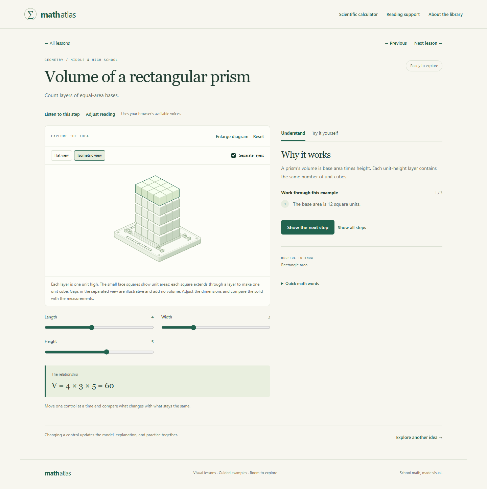

# Math Atlas

**Move a point. Change a number. Watch the idea make sense.**

Math Atlas is a free, browser-based library of interactive school math lessons. Students explore a visual model, uncover the reasoning one step at a time, and try a practice check. It spans middle school foundations through selected advanced high school topics.

**New: [Explore the student adventure](https://dancinglumberjack.github.io/math-atlas/adventure.html).** Choose a learning stage from Pre-K through introductory college explorations. Younger learners count, build, compare, and set clocks through game interactions; older learners connect visual models with numerical answers, equations, and graphs. Original woodland companions, gentle mission rewards, and a local pet collection make room for play. The presentation can become quieter and more mature as learners choose a different stage.

The adventure is a growing set of selected explorations, **not a complete Pre-K-to-college curriculum**. No accounts or classroom tracking are included. Everything still runs in the browser, with optional local progress and reading settings.

[**Open Math Atlas**](https://dancinglumberjack.github.io/math-atlas/) · [About](https://dancinglumberjack.github.io/math-atlas/about.html) · [How to use it](docs/how-to-use.md) · [Help improve it](CONTRIBUTING.md) · [Report a problem](https://github.com/dancinglumberjack/math-atlas/issues/new/choose)

The public link is hosted on GitHub Pages. You can also download `index.html` and open it in a modern browser.



## What students can do

- **Find a grade and topic in 99 adventure missions / 297 challenges.** Choose separate multiplication and division paths. Grade 3 adds 24 focused activities, with introductions before unfamiliar ideas. Four activities adapt credited, openly licensed first-edition Illustrative Mathematics lessons. [Sources and school connections](docs/learning-sources.md).
- **Build division instead of typing it.** Add or remove equal rows, change the share in each row, and watch the total change. Grade 3 division's numerical answers come from the model; other questions use clickable choices.

- **Explore 80 lessons across nine collections.** Adjust controls and compare what changes with what stays the same.
- **See the reasoning.** Reveal worked steps, follow prerequisite links, and use a small math glossary.
- **Practice without a timer.** Ask for a hint, try again, generate a new challenge, or reveal the reasoning.
- **Explore solid geometry.** Six lessons include Anatomy-powered isometric models, a flat-view comparison, and an enlarged diagram. The rectangular prism can separate into unit-height layers.
- **Calculate when useful.** A scientific calculator supports fractions, powers, roots, trigonometry, logarithms, degrees/radians, and recent calculations. A result can be copied into an active practice answer without submitting it.
- **Start with reading comfort.** New visits use clear sans-serif type, larger everyday text, spacious lines, and one worked step at a time. Adjust typeface, size, spacing, page color, contrast, motion, and the reading guide; extra reading and focus presets remain available.
- **Pick up where they left off.** Practice marks, lesson position, and reading preferences are remembered in the same browser when storage is available.

### The collections

| Collection | Lessons | Examples |
| --- | ---: | --- |
| Number sense | 11 | Signed numbers, fractions, factors, decimals, powers |
| Ratios & percents | 6 | Unit rates, proportions, scale drawings, percent change, interest |
| Pre-algebra | 6 | Expressions, equations, inequalities, coordinates |
| Algebra I | 7 | Lines, systems, functions, quadratics |
| Geometry | 18 | Area, angles, similarity, transformations, surface area, volume |
| Algebra II | 8 | Polynomial structure, radicals, exponential and logarithmic functions |
| Trigonometry | 7 | Right triangles, unit circle, radians, waves, vectors |
| Statistics & probability | 11 | Averages, variation, probability, regression, normal models |
| Advanced explorations | 6 | Sequences, complex numbers, limits, introductory derivatives and integrals |

The isometric lessons are **scale drawings, rectangular prism volume, surface area, cylinder volume, cone volume, and sphere volume**. Other lessons use diagrams chosen for the idea: number lines, fraction models, graphs, tables, and more.

## Start learning

For a playful starting point, open **Adventure map**. Choose a grade and topic, or a learning stage, then a mission. Grade 3 multiplication and division have one-click shortcuts. Each mission has three challenges: explore the model, practice the idea, and use it in another setting. Hints and worked help are free. See [the adventure guide](docs/adventure.md) for interaction, progress, and companion details.

1. Open the library and search for a topic, or choose a collection. **Find my starting point** opens the number-sense collection; it is not a placement test.
2. Open a lesson. Move one control at a time and describe what changed.
3. Read **Why it works**, then reveal the example one step at a time.
4. Choose **Try it yourself**. Use the visual, enter an answer, and check it. Hints and reasoning are always available.
5. Open **Reading support** or **Scientific calculator** whenever helpful.

See the [student, family, and teacher guide](docs/how-to-use.md) for examples, calculator notation, and troubleshooting.

Read about [the learning-access design choices](docs/learning-access.md): short visual introductions, clear steps, flexible responses, predictable controls, and quieter motion options.

## Honest limits

This is a growing learning library, **not a complete curriculum or a certified standards-aligned course**. High school placement varies, so collections describe topics rather than assigning every lesson a fixed grade.

- A **Practiced** mark means one check was answered correctly. It does not certify mastery or replace a teacher's assessment.
- The typed-equation helper accepts `ax + b = c`, with integer `a` from **1–6**, `b` from **−6–6**, and `c` from **−20–30**. For example, `3x + 4 = 16`. It is not a general symbolic solver or a photo/homework upload tool.
- Many lessons introduce a specific case of a topic. For example, fraction division starts with a unit-fraction divisor.
- Extended proofs, constructions, longer word-problem sequences, full polynomial/rational-expression operations, comprehensive statistical inference, and a complete calculus course remain outside this edition. See the [roadmap](docs/roadmap.md).
- The dyslexia and ADHD presets are adjustable presentation preferences. They do not diagnose a condition or guarantee a learning outcome. Students can combine settings to suit their own reading comfort.

## Privacy and saved work

Math Atlas has no student account, app analytics, advertising, or app backend. The lesson code runs in the browser. Progress, the saved lesson position, and reading settings use browser storage; they **do not sync** between devices, browser profiles, or site addresses. Clearing site data removes them. Private browsing or restricted storage can prevent saving, but lessons still work.

Calculator history contains the last five successful calculations in the current page and resets when the page reloads. GitHub Pages, like any web host, may receive normal connection information when someone visits the hosted site.

Do not include student names, school details, diagnoses, grades, or other identifying information in public issues or screenshots.

## Run, check, and publish your own copy

For normal use, the committed **`index.html` contains the complete lesson app**: its scripts, styles, and drawing toolkit are included. No package installation, API key, external font, or server is required to open that file. Keep `about.html` and `assets/` alongside it for the complete website, including its About page and preview image. Repository guides are separate from the lesson app.

Keep **`adventure.html`** beside these files for the student adventure and pet collection. It is also self-contained. Both learning experiences share local companion progress when visited at the same site address.

For development, install **Node.js 22 or later**, then run:

```sh
npm run build
npm test
npm run serve
```

The default build and test commands use Node's built-in tools and need no `npm install`. The serve command prints the local address to open. The tests exercise lesson models, calculator behavior, and packaging; visual and assistive-technology review still matter.

Edit the files in **`src/`**, rebuild, and commit the updated `index.html`, `adventure.html`, and `about.html` together with the source changes. Editing only a generated file will be overwritten by the next build.

To host on GitHub Pages, choose **Settings → Pages → Source → GitHub Actions**. The included Pages workflow checks and packages the site, then deploys updates pushed to `main`; it can also be started manually in **Actions**. The `.nojekyll` file keeps this a plain static site. The site address follows `https://YOUR-USERNAME.github.io/YOUR-REPOSITORY/`. Lesson links use URL fragments and work under a repository subpath.

### Repository map

```text
index.html                 Generated, self-contained app served by GitHub Pages
about.html                 Generated About page with usage and feedback links
src/                       Curriculum, interactions, styles, and HTML template
vendor/anatomy/            Included Anatomy drawing toolkit and its MIT license
scripts/                   Build and local serving tools
tests/                     Automated checks
assets/preview.png         Repository preview image
docs/                      Usage guide and roadmap
```

## Help make the next explanation better

**Students and families:** Which step finally made sense? Where did you get stuck? Tell us the lesson and the setting or example that would help.

**Teachers:** Review mathematical wording, identify misconceptions, suggest prerequisite connections, and share ideas for word problems or classroom use. Standards mapping is welcome when it is specific and reviewable.

**Designers and developers:** Improve keyboard use, screen-reader descriptions, mobile layouts, reading comfort, lesson models, and verification. A small, carefully explained improvement is valuable.

[Open an issue](https://github.com/dancinglumberjack/math-atlas/issues/new/choose), or read [Contributing](CONTRIBUTING.md) before submitting a change. Screenshots should contain only a sample problem and no personal student information.

## License and credits

Math Atlas is available under the [MIT License](LICENSE). Its isometric figures use [Anatomy](https://github.com/wheresryan22/anatomy), copyright © 2026 Ryan, also under MIT. The original license is preserved in [vendor/anatomy/LICENSE](vendor/anatomy/LICENSE). See [Third-party notices](THIRD_PARTY_NOTICES.md) for attribution and included files.
